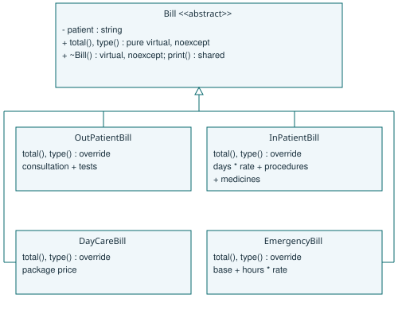

# A1 - Polymorphic bill hierarchy
## Common interface and state
Every bill stores the patient identifier and provides total(), type(), print() and a virtual destructor. The abstract total() and type() describe behaviour; print() is a shared non-virtual operation that calls these virtual functions. Patient strings are private, exposed by a const reference. There are no public owning raw pointers. Missing identifiers are rejected on construction. The program uses a patient identifier as its minimal record-presence check; it does not implement a hospital patient database.

OutPatientBill totals consultation + tests. InPatientBill totals days * per-day rate + procedures + medicines. DayCareBill uses a package price. EmergencyBill totals base + hours * hourly rate. Charges must be finite and non-negative. Constructors validate and cache the resulting total, so total() cannot fail later. The full implementation deliberately includes medicines, although the supplied B1 teaching skeleton has only surgery. This difference is intentional and leaves the supplied skeleton unchanged.



The UML marks total() and type() as pure virtual in Bill, overridden in all four concrete classes; the destructor is virtual and noexcept. print() remains shared. Derived destructors are implicitly virtual. Ownership is vector<unique_ptr<Bill>>; the virtual destructor allows deletion through that common interface.

## Day total pseudocode
```
ALGORITHM DayTotal
INPUT Bills[0..n-1], an array of references to valid bills
OUTPUT Sum, the total billed amount
BEGIN
    SET Sum TO 0
    FOR i FROM 0 TO n - 1 DO
        SET Sum TO Sum + Bills[i].total()
    END FOR
    OUTPUT Sum
END
```

## Alternative: tagged structure and switch
```
ALGORITHM TaggedTotal
INPUT Bill with Kind and numeric charge fields
OUTPUT Amount
BEGIN
    CASE Bill.Kind OF
        OP: SET Amount TO Bill.Consultation + Bill.Tests
        IP: SET Amount TO Bill.Days * Bill.Rate + Bill.Procedures + Bill.Medicines
        DC: SET Amount TO Bill.PackagePrice
        ER: SET Amount TO Bill.Base + Bill.Hours * Bill.HourlyRate
    END CASE
    OUTPUT Amount
END
```

Both approaches take O(n) time for n bills when each calculation has fixed cost. Polymorphism adds an indirect call; a switch adds a tag test or jump. Both store O(n) data. A typical polymorphic object carries a vptr plus its own fields and patient string; the owning list also stores one pointer per bill, and individual allocations have unmeasured allocator overhead. A tagged union can store the largest payload plus a tag; a naive structure stores all fields. Patient strings add O(L) storage over total identifier length L. The numeric B3 benchmark excludes this common metadata and reports actual sizeof values rather than claiming one universal layout.

Adding a bill subclass does not change Bill or the existing subclasses. The factory/composition site still needs registration. The switch representation must update its tag list and all exhaustive switches. B3 measures both using the same input. Design evidence is the UML, this algorithm and the validated B1 calculations.
