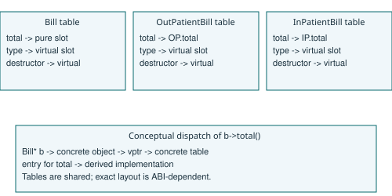

# A2 - Runtime binding and destruction
## Early and late binding
In b->show(), show() is resolved from the static Bill* type. Within show(), total() is virtual: the dynamic OPBill type determines its implementation. Thus a shared non-virtual function can invoke specialised behaviour. Qualified calls such as b->Bill::function() would suppress virtual dispatch where a base definition exists.



This is a conceptual implementation diagram, not a memory dump or a language-mandated ABI layout. Bill's total slot is pure; OP and IP point to their respective overrides. A typical implementation follows the object's vptr to the selected table entry. A table is shared per concrete class, while each object commonly has one vptr. Real ABIs can have multiple destructor entries and extra metadata.

## Prediction and observation
The exact prediction is in prediction.json, recorded before compilation and execution, with the source digest. The predicted and actual line is `500 ~OPBill ~Bill ` followed by newline. The trailing space matters. The output matches byte for byte. total() supplies 500, then deletion invokes the derived destructor followed by the base destructor.

Removing only virtual from ~Bill leaves ~OPBill() override invalid; the compiler rejects that declaration. The diagnostic source and actual compiler output are retained. After also removing the derived override specifier, delete through Bill* has undefined behaviour. No exact new output can be predicted portably. The unsafe run is isolated and its actual exit and output are in evidence/a2_unsafe.json; it is never counted as a clean sanitizer test. The local unsafe process terminated by SIGTRAP (Python return code -5), with no captured stdout or stderr and no AddressSanitizer diagnostic category. This is the observed result, not a portable predicted destructor sequence. A virtual total() does not make a non-virtual destructor safe.

## Alternative: explicit dynamic_cast chain
```
ALGORITHM TotalByCast
INPUT Base reference B
OUTPUT Amount
BEGIN
    IF B can be cast to OutPatientBill THEN
        OUTPUT OutPatientBill-specific total of B
    ELSE IF B can be cast to InPatientBill THEN
        OUTPUT InPatientBill-specific total of B
    ELSE IF B can be cast to DayCareBill THEN
        OUTPUT DayCareBill-specific total of B
    ELSE IF B can be cast to EmergencyBill THEN
        OUTPUT EmergencyBill-specific total of B
    ELSE
        REPORT unsupported bill type
    END IF
END
```

With k alternatives this performs up to k casts per bill, O(nk) tests for n bills, versus one O(1) virtual dispatch per bill in the simple hierarchy. A cast's implementation cost also depends on hierarchy complexity; the O(k) comparison assumes this fixed single-inheritance hierarchy. dynamic_cast needs a polymorphic base, so the virtual destructor still provides RTTI eligibility even if total() is made non-virtual. It does not eliminate the usual vptr. New subclasses require another cast branch; omissions become runtime errors. Runtime binding expresses this selection once in each override.
