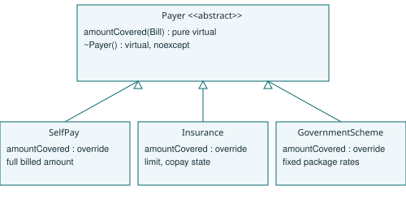

# A3 - Payer abstraction and extension
## Interface and payment rules
Payer declares virtual amountCovered(const Bill&) const = 0 and a virtual noexcept destructor. All payers operate on the same Bill interface. SelfPay returns the full bill amount: here amountCovered means the amount paid by that payer, including a patient paying personally. Insurance stores a finite non-negative limit and a copayment percentage in [0,100]. It computes bill.total() * (1 - copay/100) and rejects a claim if that insurer share exceeds the limit. It does not silently cap an invalid claim.

GovernmentScheme pays min(bill total, configured fixed package rate). For this exercise, rates are OP 1000, IP 40000, DC 18000, ER 3000. Unknown types are rejected. These are explicit test assumptions, not official hospital or insurance policy. Patient balance is total minus payer payment and remains payable after an approved partial payment. A rejected claim leaves the bill stored for correction or self-payment.



## Extension pseudocode
```
ALGORITHM CorporateCoverage
INPUT Bill
OUTPUT AmountPaidByCorporate
BEGIN
    SET AmountPaidByCorporate TO Bill.total() * 0.90
    OUTPUT AmountPaidByCorporate
END
```

CorporatePayer derives from Payer and implements this policy without editing existing classes. B4 supplies the executable extension and verifies all original tests. New behaviour must still be registered at the composition site; extension does not mean that no application wiring changes.

## Alternative: function policies
A function pointer plus a context pointer can hold a callback and separately stored limit/copay data. std::function<double(const Bill&)> can capture these values in a closure and present one callable interface.
```
ALGORITHM InsurancePolicyFunction
INPUT Bill, captured Limit and Copay
OUTPUT CoveredAmount or rejection
BEGIN
    SET CoveredAmount TO Bill.total() * (1 - Copay / 100)
    IF CoveredAmount > Limit THEN
        REPORT claim exceeds cover
    END IF
    OUTPUT CoveredAmount
END
```

Each policy call is O(1) for this fixed-rate design. A Payer object stores a typical vptr plus its state. A function pointer alone stores no policy state; a context record adds that state and lifetime management. std::function stores a type-erased wrapper, may use a small-object buffer and may allocate for a larger closure; sizes and thresholds depend on the library. Neither design makes a stateful payer free. All policies occupy O(p) space for p fixed-size policies, excluding variable rule tables. Classes suit named policies and multiple operations; function policies suit one small configurable calculation. A map of m package rates would change lookup to expected O(1) for hashing or O(log m) for an ordered map, rather than the four fixed comparisons here.
