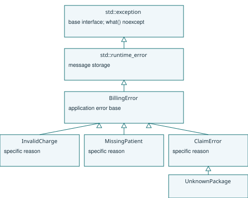

# A4 - Exception strategy
## Errors and hierarchy


BillingError derives from std::runtime_error, which derives from std::exception. InvalidCharge covers negative, nonfinite, overflowed totals, invalid durations and invalid copay percentages. MissingPatient covers an empty patient record identifier. ClaimError reports a proposed insurer payment exceeding cover. UnknownPackage specialises ClaimError. Parsing can additionally throw std::invalid_argument or std::out_of_range from std::stod; allocation can throw std::bad_alloc. Those standard exceptions are caught by const reference at the request boundary. The list applies to this in-memory model; production storage/network failures require their own adapters.

## Throwing and non-throwing functions
Bill and payer destructors are noexcept. Bill::total(), type() and patient() are noexcept because all charges are validated before an object is published and total is cached. SelfPay and CorporatePayer calculations are also noexcept for valid Bill implementations. Constructors, charge validation, Insurance::amountCovered(), GovernmentScheme::amountCovered(), parsing, vector growth and make_unique may throw. print() is not noexcept: streams can throw when exception masks are enabled. Destructors release resources and must never propagate a second exception during unwinding, which would call terminate(). Logging that could fail needs its own guarded boundary; no destructor is responsible for business error reporting.

Marking a function noexcept is a contract: a future throwing calculation must change that contract or validate earlier. It is not a general instruction to ignore errors. The interface deliberately allows amountCovered() to throw so that rejectable policies are valid overrides.

## Alternative: status propagation
```
ALGORITHM ApproveWithStatus
INPUT Billed, Cover
OUTPUT Status and Paid
BEGIN
    IF Billed < 0 OR Cover < 0 THEN
        OUTPUT InvalidAmount, 0
    ELSE IF Billed > Cover THEN
        OUTPUT ExceedsCover, 0
    ELSE
        OUTPUT Success, Billed
    END IF
END
```

A caller must inspect Status before consuming Paid and forward errors through every intermediate call. A fixed enum and double use O(1) result space (plus padding); a variable error message adds O(message length). For call depth d, status propagation costs O(d) error checks on the return route and may add checks to the success path. Exceptions skip explicit intermediate status plumbing on the success path in common table-based implementations but retain metadata/code size. Throwing needs exception-object handling and unwinds O(d) frames plus destructors; message construction and resource destruction add their own cost. The C++ standard does not promise zero-cost normal execution. B3 measures the actual implementation at three error rates. Expected, frequent rejection should normally use an explicit validation result; exceptions suit exceptional faults with recovery at a higher boundary.
