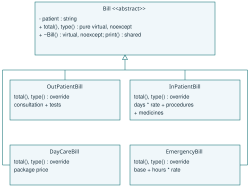
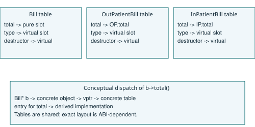
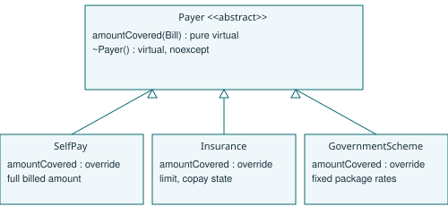
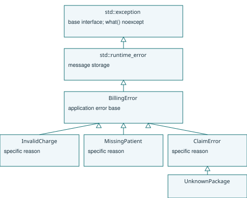

# Assignment 5 - CO5

S Vinoth Kumar | 192471006

https://github.com/vinoththecool7-netizen/DSA01-192471006-Assignment5

# A1 - Polymorphic bill hierarchy
## Common interface and state
Every bill stores the patient identifier and provides total(), type(), print() and a virtual destructor. The abstract total() and type() describe behaviour; print() is a shared non-virtual operation that calls these virtual functions. Patient strings are private, exposed by a const reference. There are no public owning raw pointers. Missing identifiers are rejected on construction. The program uses a patient identifier as its minimal record-presence check; it does not implement a hospital patient database.

OutPatientBill totals consultation + tests. InPatientBill totals days * per-day rate + procedures + medicines. DayCareBill uses a package price. EmergencyBill totals base + hours * hourly rate. Charges must be finite and non-negative. Constructors validate and cache the resulting total, so total() cannot fail later. The full implementation deliberately includes medicines, although the supplied B1 teaching skeleton has only surgery. This difference is intentional and leaves the supplied skeleton unchanged.



The UML marks total() and type() as pure virtual in Bill, overridden in all four concrete classes; the destructor is virtual and noexcept. print() remains shared. Derived destructors are implicitly virtual. Ownership is vector<unique_ptr<Bill>>; the virtual destructor allows deletion through that common interface.

## Day total pseudocode
```
ALGORITHM DayTotal
INPUT Bills[0..n-1], an array of references to valid bills
OUTPUT Sum, the total billed amount
BEGIN
    SET Sum TO 0
    FOR i FROM 0 TO n - 1 DO
        SET Sum TO Sum + Bills[i].total()
    END FOR
    OUTPUT Sum
END
```

## Alternative: tagged structure and switch
```
ALGORITHM TaggedTotal
INPUT Bill with Kind and numeric charge fields
OUTPUT Amount
BEGIN
    CASE Bill.Kind OF
        OP: SET Amount TO Bill.Consultation + Bill.Tests
        IP: SET Amount TO Bill.Days * Bill.Rate + Bill.Procedures + Bill.Medicines
        DC: SET Amount TO Bill.PackagePrice
        ER: SET Amount TO Bill.Base + Bill.Hours * Bill.HourlyRate
    END CASE
    OUTPUT Amount
END
```

Both approaches take O(n) time for n bills when each calculation has fixed cost. Polymorphism adds an indirect call; a switch adds a tag test or jump. Both store O(n) data. A typical polymorphic object carries a vptr plus its own fields and patient string; the owning list also stores one pointer per bill, and individual allocations have unmeasured allocator overhead. A tagged union can store the largest payload plus a tag; a naive structure stores all fields. Patient strings add O(L) storage over total identifier length L. The numeric B3 benchmark excludes this common metadata and reports actual sizeof values rather than claiming one universal layout.

Adding a bill subclass does not change Bill or the existing subclasses. The factory/composition site still needs registration. The switch representation must update its tag list and all exhaustive switches. B3 measures both using the same input. Design evidence is the UML, this algorithm and the validated B1 calculations.


# A2 - Runtime binding and destruction
## Early and late binding
In b->show(), show() is resolved from the static Bill* type. Within show(), total() is virtual: the dynamic OPBill type determines its implementation. Thus a shared non-virtual function can invoke specialised behaviour. Qualified calls such as b->Bill::function() would suppress virtual dispatch where a base definition exists.



This is a conceptual implementation diagram, not a memory dump or a language-mandated ABI layout. Bill's total slot is pure; OP and IP point to their respective overrides. A typical implementation follows the object's vptr to the selected table entry. A table is shared per concrete class, while each object commonly has one vptr. Real ABIs can have multiple destructor entries and extra metadata.

## Prediction and observation
The exact prediction is in prediction.json, recorded before compilation and execution, with the source digest. The predicted and actual line is `500 ~OPBill ~Bill ` followed by newline. The trailing space matters. The output matches byte for byte. total() supplies 500, then deletion invokes the derived destructor followed by the base destructor.

Removing only virtual from ~Bill leaves ~OPBill() override invalid; the compiler rejects that declaration. The diagnostic source and actual compiler output are retained. After also removing the derived override specifier, delete through Bill* has undefined behaviour. No exact new output can be predicted portably. The unsafe run is isolated and its actual exit and output are in evidence/a2_unsafe.json; it is never counted as a clean sanitizer test. The local unsafe process terminated by SIGTRAP (Python return code -5), with no captured stdout or stderr and no AddressSanitizer diagnostic category. This is the observed result, not a portable predicted destructor sequence. A virtual total() does not make a non-virtual destructor safe.

## Alternative: explicit dynamic_cast chain
```
ALGORITHM TotalByCast
INPUT Base reference B
OUTPUT Amount
BEGIN
    IF B can be cast to OutPatientBill THEN
        OUTPUT OutPatientBill-specific total of B
    ELSE IF B can be cast to InPatientBill THEN
        OUTPUT InPatientBill-specific total of B
    ELSE IF B can be cast to DayCareBill THEN
        OUTPUT DayCareBill-specific total of B
    ELSE IF B can be cast to EmergencyBill THEN
        OUTPUT EmergencyBill-specific total of B
    ELSE
        REPORT unsupported bill type
    END IF
END
```

With k alternatives this performs up to k casts per bill, O(nk) tests for n bills, versus one O(1) virtual dispatch per bill in the simple hierarchy. A cast's implementation cost also depends on hierarchy complexity; the O(k) comparison assumes this fixed single-inheritance hierarchy. dynamic_cast needs a polymorphic base, so the virtual destructor still provides RTTI eligibility even if total() is made non-virtual. It does not eliminate the usual vptr. New subclasses require another cast branch; omissions become runtime errors. Runtime binding expresses this selection once in each override.


# A3 - Payer abstraction and extension
## Interface and payment rules
Payer declares virtual amountCovered(const Bill&) const = 0 and a virtual noexcept destructor. All payers operate on the same Bill interface. SelfPay returns the full bill amount: here amountCovered means the amount paid by that payer, including a patient paying personally. Insurance stores a finite non-negative limit and a copayment percentage in [0,100]. It computes bill.total() * (1 - copay/100) and rejects a claim if that insurer share exceeds the limit. It does not silently cap an invalid claim.

GovernmentScheme pays min(bill total, configured fixed package rate). For this exercise, rates are OP 1000, IP 40000, DC 18000, ER 3000. Unknown types are rejected. These are explicit test assumptions, not official hospital or insurance policy. Patient balance is total minus payer payment and remains payable after an approved partial payment. A rejected claim leaves the bill stored for correction or self-payment.



## Extension pseudocode
```
ALGORITHM CorporateCoverage
INPUT Bill
OUTPUT AmountPaidByCorporate
BEGIN
    SET AmountPaidByCorporate TO Bill.total() * 0.90
    OUTPUT AmountPaidByCorporate
END
```

CorporatePayer derives from Payer and implements this policy without editing existing classes. B4 supplies the executable extension and verifies all original tests. New behaviour must still be registered at the composition site; extension does not mean that no application wiring changes.

## Alternative: function policies
A function pointer plus a context pointer can hold a callback and separately stored limit/copay data. std::function<double(const Bill&)> can capture these values in a closure and present one callable interface.
```
ALGORITHM InsurancePolicyFunction
INPUT Bill, captured Limit and Copay
OUTPUT CoveredAmount or rejection
BEGIN
    SET CoveredAmount TO Bill.total() * (1 - Copay / 100)
    IF CoveredAmount > Limit THEN
        REPORT claim exceeds cover
    END IF
    OUTPUT CoveredAmount
END
```

Each policy call is O(1) for this fixed-rate design. A Payer object stores a typical vptr plus its state. A function pointer alone stores no policy state; a context record adds that state and lifetime management. std::function stores a type-erased wrapper, may use a small-object buffer and may allocate for a larger closure; sizes and thresholds depend on the library. Neither design makes a stateful payer free. All policies occupy O(p) space for p fixed-size policies, excluding variable rule tables. Classes suit named policies and multiple operations; function policies suit one small configurable calculation. A map of m package rates would change lookup to expected O(1) for hashing or O(log m) for an ordered map, rather than the four fixed comparisons here.


# A4 - Exception strategy
## Errors and hierarchy


BillingError derives from std::runtime_error, which derives from std::exception. InvalidCharge covers negative, nonfinite, overflowed totals, invalid durations and invalid copay percentages. MissingPatient covers an empty patient record identifier. ClaimError reports a proposed insurer payment exceeding cover. UnknownPackage specialises ClaimError. Parsing can additionally throw std::invalid_argument or std::out_of_range from std::stod; allocation can throw std::bad_alloc. Those standard exceptions are caught by const reference at the request boundary. The list applies to this in-memory model; production storage/network failures require their own adapters.

## Throwing and non-throwing functions
Bill and payer destructors are noexcept. Bill::total(), type() and patient() are noexcept because all charges are validated before an object is published and total is cached. SelfPay and CorporatePayer calculations are also noexcept for valid Bill implementations. Constructors, charge validation, Insurance::amountCovered(), GovernmentScheme::amountCovered(), parsing, vector growth and make_unique may throw. print() is not noexcept: streams can throw when exception masks are enabled. Destructors release resources and must never propagate a second exception during unwinding, which would call terminate(). Logging that could fail needs its own guarded boundary; no destructor is responsible for business error reporting.

Marking a function noexcept is a contract: a future throwing calculation must change that contract or validate earlier. It is not a general instruction to ignore errors. The interface deliberately allows amountCovered() to throw so that rejectable policies are valid overrides.

## Alternative: status propagation
```
ALGORITHM ApproveWithStatus
INPUT Billed, Cover
OUTPUT Status and Paid
BEGIN
    IF Billed < 0 OR Cover < 0 THEN
        OUTPUT InvalidAmount, 0
    ELSE IF Billed > Cover THEN
        OUTPUT ExceedsCover, 0
    ELSE
        OUTPUT Success, Billed
    END IF
END
```

A caller must inspect Status before consuming Paid and forward errors through every intermediate call. A fixed enum and double use O(1) result space (plus padding); a variable error message adds O(message length). For call depth d, status propagation costs O(d) error checks on the return route and may add checks to the success path. Exceptions skip explicit intermediate status plumbing on the success path in common table-based implementations but retain metadata/code size. Throwing needs exception-object handling and unwinds O(d) frames plus destructors; message construction and resource destruction add their own cost. The C++ standard does not promise zero-cost normal execution. B3 measures the actual implementation at three error rates. Expected, frequent rejection should normally use an explicit validation result; exceptions suit exceptional faults with recovery at a higher boundary.


# A5 - Recovery, rethrowing and resource lifetime
## Catch boundaries and bill retention
Construction validates a candidate before ownership enters the bill collection. During claim processing the bill remains owned by vector<unique_ptr<Bill>>; claim failure does not erase it. The claim service catches ClaimError by const reference, writes an audit message, and uses throw; to preserve the active exception. A per-request boundary reports the reason and continues to the next request. A final catch(...) handles unexpected types at that boundary. Continuing means the error was isolated to one request, not that an arbitrary corrupted process is recoverable.

```
ALGORITHM ProcessClaims
INPUT StoredBills and SelectedPayer
OUTPUT Per-bill decisions and retained bills
BEGIN
    FOR EACH Bill IN StoredBills DO
        TRY
            TRY
                SET Paid TO SelectedPayer.amountCovered(Bill)
            CATCH ClaimError AS Error
                LOG Error
                RETHROW current exception
            END TRY
            OUTPUT approved payment Paid
        CATCH standard exception AS Error
            OUTPUT rejection reason Error
        CATCH any other exception
            OUTPUT unexpected failure for current bill
        END TRY
        RETAIN Bill in StoredBills
    END FOR
END
```

A logging failure must not replace the original exception; the supplied demonstration uses ordinary non-throwing stream settings. A production audit sink should offer an explicit failure policy.

## Prediction and observation
prediction.json records `~f ~main caught 42` followed by newline before first execution. Actual output matches exactly. f's local guard dies first as its stack frame unwinds, then main's guard inside the try block dies, then the matching catch(int) prints 42. Control transfers out of f immediately on throw, so the statement printing "not printed" is never reached. main's guard is scoped inside the try, not around the handler.

RAII ties ownership to object lifetime: unique_ptr frees an allocation, vector releases owned elements, and a file stream closes its handle while unwinding. Only fully constructed objects are destroyed. If a constructor throws, its completed members and bases are destroyed, but that object's own destructor is not called.

## Alternative: manual cleanup
```
ALGORITHM WorkWithManualCleanup
INPUT Request
OUTPUT Result or failure
BEGIN
    ALLOCATE Resource
    TRY
        PROCESS Request using Resource
    CATCH any exception
        RELEASE Resource
        RETHROW current exception
    END TRY
    RELEASE Resource
END
```

For r resources, releases still take O(r) work with either design. Manual cleanup requires matching releases on success and every escaping path: r resources and e independent exits can create up to r*e cleanup obligations. Adding one unhandled exit creates up to r leak opportunities; a new acquisition that throws part way through needs special partial-construction cleanup. A shared cleanup block can reduce duplication, but then it is effectively rebuilding an RAII owner. RAII puts each resource's release rule in one owner and allows O(r) state, without adding a release to every new catch block. B2 checks printed guard destruction and live-count restoration, and B4 repeats original billing tests after extension under AddressSanitizer.


# B1 - Billing implementation and validation
## Completed supplied program
complete.cpp replaces only the three TODO regions. The attachment's final closing brace was swallowed by a // comment during pasting; it is restored on its own line. No other teaching-skeleton behaviour is hardened or replaced. expected.txt is the supplied expected output, consumed by scripts/verify.py and compared byte for byte.

The observed output is OP Ravi: 1700, IP Meena: 47500, Total 49200 on three lines. The full implementation is separate in include/billing.hpp. It uses validated constructors, immutable cached totals and unique ownership. No interactive input is required; embedded fixtures are the actual inputs, not unused input files.

## Independent expected values
| Bill and hand calculation | Total | SelfPay | Insurance 20% copay | Government |
| --- | --- | --- | --- | --- |
| OP: 500 + 1200 | 1700 | 1700 | 1360 | 1000 |
| IP: 3*2500 + 40000 + 500 | 48000 | 48000 | 38400 | 40000 |
| DC: package | 20000 | 20000 | 16000 | 18000 |
| ER: 1000 + 2*750 | 2500 | 2500 | 2000 | 2500 |

The insurer cover is 50000. The day's total is 72200. Tests use independent constants for all 12 bill/payer combinations, plus zero charges, an exact-cover boundary and 100% copay. All pass. These examples use exactly representable totals, so assertions compare exactly; a general fractional-currency system needs integer minor units or a specified rounding policy.

## Runtime binding and destructor experiments
Removing virtual from a pure virtual total() is ill-formed: a non-virtual function cannot be declared pure, and the derived override declarations no longer override. See nonvirtual_pure.cpp.txt and the captured diagnostic. It has no runtime output. To demonstrate changed runtime behaviour, early_binding.cpp is a separate legal program: total() has a concrete non-virtual base implementation returning zero and derived overrides are replaced by hiding methods. Through Bill* it prints `0 0 Total 0`. This distinguishes a compile failure from early binding.

The A2 non-virtual-destructor experiment is reused for B1.4; it removes both the base virtual destructor keyword and the now-invalid derived override specifier, then runs in an isolated ASan process. Its nonzero result is an unsafe observation, not evidence of a clean program. See A2/evidence/a2_unsafe.json for the actual termination. Destructor-chain output is guaranteed only in the correct virtual-destructor version.

## Design comparison and template alternative
The implementation preserves A1/A3 interfaces and all four bill types. Validation is done at construction and totals are cached so noexcept is justified. The skeleton's IP example omits medicines while the full design includes them. Types and patient strings remain shared metadata; factories establish ownership.
```
ALGORITHM TotalHomogeneousContainers
INPUT OPBills, IPBills, DCBills, ERBills
OUTPUT Sum
BEGIN
    SET Sum TO 0
    FOR EACH Container IN the four statically typed containers DO
        FOR EACH Bill IN Container DO
            SET Sum TO Sum + statically bound total of Bill
        END FOR
    END FOR
    OUTPUT Sum
END
```

A C++ template function sum(container) instantiates the inner loop for each container. Total time is O(n); calls can inline and object storage can be contiguous without a vptr if value types are independent of Bill. Space is O(n+k) for n values and k container headers, with unused capacities depending on allocation strategy. A single arbitrary mixed-order list is lost unless an extra tag/index, variant, or type-erased layer restores that ordering. New bill types need another container and registration at the aggregate site. B3 compares dynamic representations, not a claim that templates are always faster.


# B2 - Engineered failures and recovery
## Constructed errors
errors.cpp executes nine deliberate requests: negative consultation, insurer share above cover, unknown government package, text passed to stod, missing patient identifier, an unexpected integer exception, NaN charge, copay over 100%, and numeric parse overflow. Each request owns a vector of bills and an allocated array. A stack guard prints ~scope and maintains a live count. An extra bill owned through unique_ptr<Bill> prints ~tracked-bill from its overridden destructor, with a separate live count. All nine failures are caught at the per-request boundary and both live counts return to zero. The integer reaches catch(...), after which processing continues. This shows both typed recovery and the fallback path; standard-library RAII destructors are not individually instrumented.

allocation.cpp forces a real new expression to throw std::bad_alloc through a class-specific failing allocation function. This deterministic fault injection avoids an ASan oversized-allocation abort or operating-system overcommit, neither of which reliably produces a catchable bad_alloc. It tests the catch and unwinding path, not physical memory exhaustion. The guard is destroyed and the handler reports std::bad_alloc. This is the documented mechanism used to force allocation failure.

## Prediction and completed code
The exact B2 prediction is `ok done caught negative [log too large] caught too large ` followed by newline, recorded before execution and verified byte for byte. 100 passes validation and prints done. -5 throws invalid_argument and bypasses the out_of_range-only logger; main catches it as std::exception. 2000000 throws out_of_range, is logged in process(), rethrown, and is finally reported by main. Only that type is logged.

The supplied approve/settle skeleton is completed independently and matches expected.txt exactly: approved 40000; audit: exceeds cover; claim rejected: exceeds cover; error: negative amount, each on its own line. settle catches only ClaimError; a negative amount bypasses it. The outer handler catches ClaimError before std::exception.

throw; rethrows the current exception with its dynamic type and identity. throw e; creates a new exception object from e's static ClaimError type. In the supplied code the dynamic type is already ClaimError, so the visible output may not change. slicing.cpp throws a Detailed subclass and proves the distinction: throw; reaches the Detailed handler, while throw e; reaches the ClaimError handler after slicing. Throwing a base reference by value must not be described as preserving derived information.

## Optional alternative and cost
```
ALGORITHM ApproveOptional
INPUT Billed, Cover
OUTPUT OptionalPaid
BEGIN
    IF Billed < 0 OR Cover < 0 OR Billed > Cover THEN
        OUTPUT no value
    ELSE
        OUTPUT value Billed
    END IF
END
```

No value means rejected, so the caller must test presence; it loses a detailed rejection reason unless another error field is added. B3 measures optional, enum-style status and exceptions on the same million inputs at 0%, 1% and 50% negative values. Each is O(n) overall; the error proportion changes constants dramatically. optional<double> adds an engagement flag and possible padding; its observed size is recorded in the benchmark. An exception result returns an ordinary double on success and uses separate exceptional storage on failure, with metadata and unwind costs that sizeof(double) does not capture. See B3 for raw repetitions, medians, checksums and actual results.


# B3 - Measured dispatch and error cost
## Workload and correctness
benchmark.cpp uses four numeric bill layouts with deterministic data: type = i mod 4, a = 100 + (i mod 97), b = 2, c = 50. OP is a+b, IP is a*b+c, DC is a, ER is a+b*c. The 10 independent hand results are 102, 252, 102, 203, 106, 260, 106, 207, 110, 268: sum 1716. Virtual, switch and variant results each match all ten constants. Larger sizes use a separately accumulated analytic expectation, and every measured sum must match it.

The virtual version stores separately allocated objects through unique_ptr. The switch and variant versions are contiguous value arrays. Variant alternatives are value-only types so they do not redundantly carry a virtual base. Patient strings, payer work and constructor validation are excluded equally: this experiment measures numeric traversal and representation, not complete hospital throughput. Creation and destruction are outside each timed interval. Each representation is built and released separately to limit peak memory.

## Measurement method
Compile with g++ -std=c++17 -Wall -Wextra -O2, without ASan, as requested for timings. Each condition runs three times using steady_clock; raw milliseconds and checksums are retained. All three dispatch paths use a noinline wrapper so calls cannot simply be folded away. Virtual dispatch includes a second indirect call and pointer traversal, and contiguous alternatives benefit from locality. Results therefore compare the implemented representations and include wrapper overhead; they do not isolate an abstract instruction cost. No volatile operation is placed in the inner loop; the final sum is checked and consumed by a volatile sink.

Validators also have the same noinline boundary. A prebuilt million-element input has exactly 0, 10000, or 500000 negative values. The pattern uses (i*37 mod 100) to intersperse errors deterministically. It is not random hospital data. Validation loops count rejects and check the sum. Exceptions construct and throw invalid_argument for each negative, while status and optional return a rejection without throwing. No audit logging is timed.

### Median traversal time (milliseconds; 3 repetitions)

| Bills | Virtual | Switch | Variant |
| --- | --- | --- | --- |
| 1,000 | 0.002792 | 0.002000 | 0.002292 |
| 1,000,000 | 2.760625 | 2.071292 | 2.263250 |
| 10,000,000 | 30.578125 | 25.601167 | 22.623625 |

### Median validation time (1,000,000 inputs; milliseconds)

| Invalid | Status | Exceptions | Optional |
| --- | --- | --- | --- |
| 0% | 2.264875 | 2.708166 | 2.256083 |
| 1% | 2.255458 | 231.753209 | 2.252667 |
| 50% | 2.252792 | 10954.148250 | 2.253916 |

For 10,000,000 bills, the observed medians were 30.578 ms virtual, 25.601 ms switch and 22.624 ms variant. Here the contiguous variant was fastest, with differences that include locality and allocation layout as well as dispatch. At 1% invalid inputs, exceptions took 231.753 ms compared with 2.255 ms for status. At 50%, repeated unwinding dominates. At 0%, the measured exception success path is close to the explicit-result paths.

Observed sizes in bytes: Base 8, OP 24, IP 32, DC 16, ER 32; owning pointer 8; switch 32; variant 32; optional<double> 16; status int 4. A virtual bill in the measured container therefore requests object bytes plus an 8-byte list slot; allocation overhead is extra. These values are platform-specific.

## Interpretation and alternatives
All fixed-type traversals take O(n) time and O(n) input storage. A virtual object commonly adds a vptr, a list pointer and separate allocator metadata. A switch stores its numeric payload plus tag and alignment padding. A variant stores its largest alternative plus discriminator and padding. Actual sizeof measurements above exclude allocator overhead and vector spare capacity. Shared virtual tables cost O(k) per hierarchy, not one entire table per object.

std::visit provides a closed set of alternatives and compile-time checking of the visitor. New alternatives require editing the variant alias and ensuring all visitors support them. It can retain mixed input order in one contiguous list. It is suitable when the set is known; a subclass interface is suitable when extensions arrive independently. A switch is straightforward for a small closed set but duplicates dispatch logic wherever operations are added.

For n validations with fraction p errors, all approaches remain O(n) for fixed-depth handling. Exception costs include O(p*n) allocations/unwinds with large implementation-dependent constants; status/optional have cheap explicit branches for expected invalid data. Measurements are three local repetitions, not independent end-to-end production trials. Cache state, order, allocator and the compiler matter. A 1000-element traversal is especially affected by clock and call overhead. There is no claim of a universal ranking or extrapolated service-level guarantee.


# B4 - Extension and engineering decision
## Practical extension
extension.hpp adds TelemedicineBill with minutes * per-minute rate and CorporatePayer paying 90% of any Bill total. These derive only from the existing interfaces; include/billing.hpp and the existing bill/payer classes are unchanged by the extension. main.cpp reruns the exact B1 originalTests() function, then accesses both new objects through base-class unique_ptrs. A 30-minute consultation at 40 totals 1200; corporate pays 1080. A government claim on the new TELE type throws UnknownPackage and is recovered without destroying the stored bill prematurely. The unknown-package rejection is deliberate: a fixed package payer must not invent a rate for a new bill type.

## Resource evidence
The extension run compiles with -fsanitize=address -g -fno-omit-frame-pointer. It exits zero with no sanitizer diagnostic while including thrown and caught UnknownPackage. The B2 error runs likewise release their scoped ownership and restore the guard count. The isolated A2 undefined-behaviour run is excluded from this clean claim. leak_probe.txt records that detect_leaks=1 is unsupported on this local platform, so these results establish clean observed address checks and RAII behaviour, not independent LeakSanitizer certification. No Linux CI result is asserted.

## Decision for the hospital group
The group adds two bill types and three payer policies a year across 15 hospitals. The extension shows that adding one of each requires two new classes and composition/test updates, with no changes to the four original bill classes or three original payer classes. This favours polymorphic interfaces at the business boundary. The dispatch measurement is a numeric loop with no databases, invoices, audit persistence or network calls; 200000 bills a day alone does not establish a throughput bottleneck. Multiplying a tiny benchmark by daily bill count would conceal those unmeasured costs.

Use exceptions for unexpected missing records, allocation failure and internal faults, with per-request recovery and durable audit. Use explicit validation results for frequent routine claim rejection: the measured high-error exception path is expensive. A production system should preserve bills transactionally, represent currency in integer minor units with specified rounding, validate configuration before activation, and retry only operations with an idempotency policy. Those storage and accounting features are beyond this in-memory assignment, so "never lose a bill" here means retaining the owning collection during claim errors, not durability through power loss.

## Configuration plug-in alternative
```
ALGORITHM EvaluateConfiguredBill
INPUT ValidatedRule, ChargeFields
OUTPUT Total
BEGIN
    SET Total TO 0
    FOR EACH Term IN ValidatedRule.Terms DO
        VALIDATE referenced charge field
        SET Total TO Total + evaluated Term
    END FOR
    OUTPUT Total
END
```

A configuration registry could map bill codes to rate formulas and payer codes to coverage rules. Validate schemas, bounds, allowed operations and versions before activation; retain the rule version with each bill so historical amounts stay reproducible. A rule with r terms costs O(r) per bill instead of one O(1) cached virtual total; parsing and validation cost O(R) for R total rule size at load time. Storage is O(R) plus per-bill referenced data. If rules are compiled/cached, the online calculation can approach the existing constant cost. A fixed rule format is easy to update for rates but cannot express arbitrary new clinical logic without an engine extension. Unrestricted native plug-ins add ABI, lifetime and crash risks; a rate configuration is data, not automatically executable code. Class extensions are type checked but need rebuilding and deployment. Versioned configuration is appropriate for rates; a small stable polymorphic layer remains useful for distinct behaviour.
